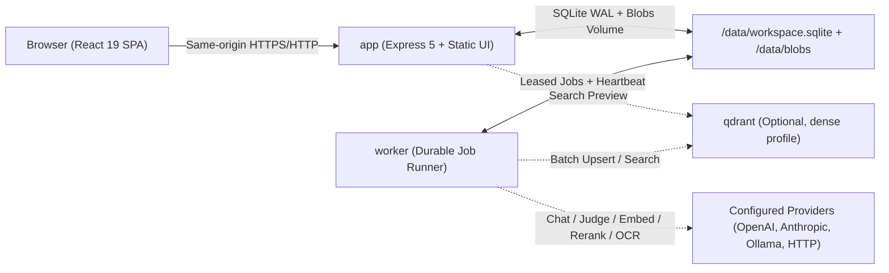

# RAG Evaluation Lab

RAG Evaluation Lab is a self-hosted, open-source workbench for building, comparing, and auditing Retrieval-Augmented Generation (RAG) pipelines. Every dataset revision, chunked index generation, pipeline revision, experiment run, retrieved evidence item, generated answer, judge attempt, and provider cost record is persisted in SQLite and executed by a durable background worker—so you can run offline keyword retrieval comparisons with zero API keys, reload or close your browser without losing work, and optionally add OpenAI, Anthropic, or local OpenAI-compatible models for dense/hybrid retrieval, answer generation, structured judging, and human-reviewed synthetic test-set generation.

---

## Quick Start (Docker Compose — Under 5 Minutes)

No API keys, cloud accounts, or model downloads are required to run your first comparison. Excluding initial Docker image download, the workflow below takes under five minutes:

1. **Clone and start the stack**

   ```bash
   git clone https://github.com/farhan1301/RAG-Evaluation-Lab.git
   cd RAG-Evaluation-Lab
   docker compose up --build
   ```

   This builds a single multi-stage Node 26 image and starts `app` (serving the built frontend and `/api/v1` on one origin at `http://127.0.0.1:7070`) and `worker` (executing background parsing, indexing, experiment, and generation jobs against a shared named SQLite + blobs volume).

2. **Open the application**

   Visit [http://127.0.0.1:7070](http://127.0.0.1:7070) in your browser.

3. **Load the labeled sample dataset**

   Navigate to **Datasets & Tasks** and click **Load Sample Dataset**. This creates the labeled RAG fundamentals corpus (3 documents and 10 tasks—9 answerable and 1 unanswerable—with complete graded document-level qrels `0–3`).

4. **Compare two retrieval pipelines**
   - Open **Pipelines**, create a baseline keyword pipeline (SQLite FTS5 BM25, `topK: 5`), and click **Duplicate** to create an independent copy.
   - Change a retrieval or chunking parameter on the copy (for example, `topK: 1` or `sentence-packed` chunking) and save.
   - Open **Experiments**, select the sample dataset and both pipelines, choose **Retrieval-only** mode, and start the run.
   - Close or refresh the browser at any time—progress and results stay in SQLite. Open **Reports** or **History** to inspect paired deltas, per-task retrieved passage diffs, and export Markdown, JSON, or paginated print/PDF reports.

### Enabling Dense and Hybrid Retrieval in Compose

`qdrant` is included in `compose.yaml` under the optional `dense` profile so the default quick start stays lightweight and requires no extra image downloads. To enable dense or hybrid retrieval:

1. Copy `.env.example` to `.env`, set `QDRANT_URL=http://qdrant:6333`, and configure an embedding profile (OpenAI `OPENAI_API_KEY` + `OPENAI_EMBED_MODEL=text-embedding-3-small`, or a local endpoint such as Ollama via `LOCAL_EMBED_BASE_URL` + `LOCAL_EMBED_MODEL`).
2. Start with the `dense` profile:

   ```bash
   docker compose --profile dense up --build
   ```

---

## Native Development Setup

Requires **Node.js `^22.22.0 || ^24.0.0 || >=26.0.0`** (tested on Node 22.22.3 and 26.13.1) and npm workspaces (`packages/contracts`, `backend`, `frontend`).

```bash
cp .env.example .env.local
npm ci
```

Start the three development processes in separate terminals:

```bash
# Terminal 1 — Express API (http://127.0.0.1:7070)
npm run dev:backend

# Terminal 2 — Durable background worker
npm run dev:worker

# Terminal 3 — Vite frontend dev server (http://127.0.0.1:3000, proxies /api -> 7070)
npm run dev
```

- Node loads `.env.local` and `.env` from the repository root (process environment variables take precedence, followed by `.env.local`).
- On Node 22, `node:sqlite` emits an expected `ExperimentalWarning` on stderr. All SQLite usage is isolated inside `backend/src/db/`.
- **Native single-origin production run:**

  ```bash
  npm run build
  NODE_ENV=production npm start -w rag-eval-backend
  npm run start:worker
  ```

---

## Provider Setup

All provider credentials and upstream endpoint URLs remain strictly on the server. Application code contains no hard-coded default model IDs; configure each role explicitly in `.env` or `.env.local` (see [`.env.example`](.env.example)):

| Provider / Capability                                                  | Required Variables                                                                                                                                        | Notes & Examples                                                                                                                                                                                                   |
| ---------------------------------------------------------------------- | --------------------------------------------------------------------------------------------------------------------------------------------------------- | ------------------------------------------------------------------------------------------------------------------------------------------------------------------------------------------------------------------ |
| **OpenAI** (chat, judge, embeddings)                                   | `OPENAI_API_KEY`, plus `OPENAI_CHAT_MODEL` (set to a current model), `OPENAI_JUDGE_MODEL` (optional; defaults to chat model), and/or `OPENAI_EMBED_MODEL` | Embedding example: `text-embedding-3-small`. Optional: `OPENAI_EMBED_DIMENSIONS`, `OPENAI_BASE_URL`, `OPENAI_CHAT_SUPPORTS_TEMPERATURE`.                                                                           |
| **Anthropic** (chat, judge)                                            | `ANTHROPIC_API_KEY`, `ANTHROPIC_CHAT_MODEL`, optional `ANTHROPIC_JUDGE_MODEL`                                                                             | Model examples: `claude-sonnet-5-5`, `claude-opus-5-5`, `claude-haiku-5-5`. Pair with OpenAI or local embeddings for dense/hybrid retrieval.                                                                       |
| **Local / Ollama Embeddings** (dense & hybrid without a cloud account) | `LOCAL_EMBED_BASE_URL`, `LOCAL_EMBED_MODEL`, `QDRANT_URL`                                                                                                 | Point to an OpenAI-compatible endpoint such as Ollama: `http://127.0.0.1:11434/v1` (native) or `http://host.docker.internal:11434/v1` (Docker Compose). Optional: `LOCAL_EMBED_API_KEY`, `LOCAL_EMBED_DIMENSIONS`. |
| **Local / Ollama Chat & Judge**                                        | `LOCAL_CHAT_BASE_URL`, `LOCAL_CHAT_MODEL`, optional `LOCAL_JUDGE_MODEL`                                                                                   | Optional flags: `LOCAL_CHAT_SUPPORTS_TEMPERATURE=true`, `LOCAL_CHAT_SUPPORTS_STRUCTURED_OUTPUT=false`.                                                                                                             |
| **HTTP Reranker**                                                      | `RERANK_BASE_URL`, `RERANK_MODEL`                                                                                                                         | Accepts `{ model, query, documents, top_n }` and returns validated candidate indices/scores. Pipelines select `fail` or `fallback` failure policy. Optional: `RERANK_API_KEY`.                                     |
| **Qdrant Vector Store**                                                | `QDRANT_URL`                                                                                                                                              | Required only for `dense` and `hybrid` retrieval (`keyword` FTS5 works without Qdrant). Optional: `QDRANT_API_KEY`, `QDRANT_COLLECTION` (default `rag-eval-chunks`), `QDRANT_REQUIRED=true`.                       |
| **LlamaParse Cloud Parser**                                            | `LLAMA_CLOUD_API_KEY`                                                                                                                                     | Enables `.docx` and scanned/image PDF extraction. Local `.txt`, `.md`, and text-layer `.pdf` parsing works offline with zero credentials.                                                                          |
| **Pricing & Budgets**                                                  | `PRICE_SCHEDULE_JSON` or `PRICE_SCHEDULE_PATH`, `RUN_MAX_TOKENS`, `RUN_MAX_COST_USD`                                                                      | Models without an explicit price entry report cost as `unknown` (never estimated).                                                                                                                                 |

---

## Architecture



### Repository Layout

```text
packages/contracts/    Shared Zod schemas, wire DTOs, metric identifiers
backend/src/
  config/              Validated env parsing and safe capability projection
  db/                  node:sqlite migrations, repositories, online backup/restore
  http/                Express app factory, /api/v1 routes, static SPA serving
  jobs/                Durable SQLite queue, leases, fencing tokens, worker entry
  ingestion/           Bounded blob uploads, local/LlamaParse parsers, chunkers
  retrieval/           Immutable index generations, FTS5, Qdrant, RRF, rebuild
  providers/           OpenAI, Anthropic, OpenAI-compatible, and HTTP reranker
  evaluation/          Deterministic metrics, versioned judge rubrics, pricing
  generation/          Synthetic Q&A generator, span validation, leakage checks
  reporting/           Paired comparisons, bootstrap CIs, exports, derived docs
  ops/                 Backup, restore, Qdrant rebuild, and worker health CLIs
frontend/src/          React 19 + Router 8 + TanStack Query + Tailwind 4 UI
tests/                 Vitest unit, HTTP, DB, recovery, and Qdrant integration tests
e2e/                   Playwright browser workflow and provider-fixture tests
```

### Startup & Migration Ordering

Both `app` and `worker` call `openDatabase()` at startup, which configures `PRAGMA busy_timeout=5000`, `PRAGMA foreign_keys=ON`, `PRAGMA journal_mode=WAL`, and executes pending SQL migrations inside a `BEGIN IMMEDIATE` transaction guarded by `PRAGMA user_version`. In `compose.yaml`, `worker` uses `depends_on: app: condition: service_started` (rather than `service_healthy`, which would deadlock because `app`'s `/health/ready` requires a fresh worker heartbeat in SQLite). Because migrations are serialized and idempotent via `PRAGMA user_version`, either process can start safely without racing or corrupting schema state.

---

## Metrics Explained

### Deterministic Document-Level Retrieval Metrics

Retrieval is scored at the **document level** by default so changing chunk sizes does not invalidate gold labels. Retrieved chunks are collapsed to unique documents at first occurrence, preserving rank order. Let $R$ be the set of positively graded gold documents ($g_i \in \{0,1,2,3\}$), and $b_i = 1$ if $g_i > 0$ else $0$.

| Metric               | Formula                                                                                             | Notes                                                                         |
| -------------------- | --------------------------------------------------------------------------------------------------- | ----------------------------------------------------------------------------- |
| **Hit@k**            | $1$ if $\exists i \le k: b_i = 1$, else $0$                                                         | Macro mean across eligible tasks.                                             |
| **Precision@k**      | $\frac{1}{k}\sum_{i=1}^{k} b_i$                                                                     | Returning fewer than $k$ documents keeps $k$ in the denominator.              |
| **Recall@k**         | $\frac{1}{\|R\|}\sum_{i=1}^{k} b_i$                                                                 | Denominator includes all positive gold documents, including unretrieved ones. |
| **MRR@k**            | $\frac{1}{\text{first positive rank}}$ if $\le k$, else $0$                                         | Mean reciprocal rank through cutoff $k$.                                      |
| **MRR (full depth)** | $\frac{1}{\text{first positive rank}}$ across evaluated depth, else $0$                             | Records evaluated `topK` depth and returned document count.                   |
| **nDCG@k**           | $\text{DCG}@k / \text{IDCG}@k$, where $\text{DCG}@k = \sum_{i=1}^{k} \frac{2^{g_i}-1}{\log_2(i+1)}$ | Ideal DCG orders all positive gold grades through $k$.                        |

- **Hybrid fusion (RRF):** $\text{score}(d) = \sum_s \frac{w_s}{60 + \text{rank}_s(d)}$, tie-broken deterministically by stable chunk ID.
- **Partial labeling pools:** Unjudged documents receive grade `0`, and `judgedCoverage` is reported alongside pooled estimates.
- **Distinct exclusion statuses:** An eligible task with empty successful retrieval scores `0`. Failed retrieval (`retrieval_failed`), unanswerable tasks (`unanswerable`), missing qrels (`missing_qrels`), and tasks with zero positive gold documents (`no_relevant_docs`) record `value: null` with explicit counts rather than distorting means.

### Structured LLM-Judge & Abstention Metrics

Judge calls use versioned rubrics (`backend/src/evaluation/rubrics/*.json`), blind the judge to pipeline identity, treat retrieved passages as quoted data, and validate all returned `chunkId` evidence against the exact context passed to the answer model.

| Metric                                                   | Formula / Rubric                                                                                                                                                                                                   |
| -------------------------------------------------------- | ------------------------------------------------------------------------------------------------------------------------------------------------------------------------------------------------------------------ |
| **Faithfulness / groundedness**                          | $\text{supported claims} / \text{total factual claims}$ (atomic claim decomposition with validated `chunkId` citations).                                                                                           |
| **Answer relevance**                                     | $\text{grade} / 4$ on an anchored `0–4` scale (`0` off-topic, `1` tangential, `2` partially responsive, `3` directly responsive with minor omission, `4` fully responsive).                                        |
| **Judged passage usefulness (Judged context precision)** | $\text{useful passages} / \text{delivered passages}$ (answerable empty retrieval records `0`).                                                                                                                     |
| **Judged context recall**                                | $\text{supported reference facts} / \text{total reference facts}$ (requires reviewed `referenceFacts`).                                                                                                            |
| **Answer correctness**                                   | $\text{satisfied reference facts} / \text{total reference facts}$, with a separate `criticalContradiction` flag and versioned pass policy (`minScore >= 0.8`, no critical contradiction, acceptance criteria met). |
| **Abstention (answerable / unanswerable)**               | Reported as two separate metrics: answer attempt rate on answerable tasks, and abstention accuracy on unanswerable tasks.                                                                                          |

### Null-on-Failure, Comparisons, Latency & Unknown Pricing

- **Null-on-failure rule:** Timeout, judge refusal, malformed JSON, schema mismatch, or unresolved evidence `chunkId`s produce a `null` observation with an explicit status (`judge_timeout`, `judge_refused`, `judge_malformed`, `unresolved_evidence`, `judge_failed`)—never coerced to `0`. One bounded repair attempt is permitted and both attempts are retained in `judge_attempts`. `completionRate` is reported alongside every aggregate mean.
- **Paired comparisons & bootstrap CIs:** Comparisons pair observations on identical `taskVersionId`, dataset revision, metric version, evaluation unit, and cutoff (plus identical judge model/settings and rubric version for judge deltas). For $\ge 5$ paired tasks, reports include a deterministic task-level paired percentile bootstrap interval (`seed=42`, $B=1000$, 95% CI). Incompatible runs remain inspectable side by side with incompatible fields highlighted; no winner is declared from unpaired averages.
- **Latency:** Queue wait, index build time, serving latency (retrieval + rerank + generation), and evaluation (judge) latency are tracked separately with nearest-rank `p50`/`p95` and sample sizes.
- **Unknown pricing:** Costs are computed only from actual provider token/request usage and an explicit operator-configured price schedule (`PRICE_SCHEDULE_JSON` / `PRICE_SCHEDULE_PATH`). Unconfigured models always report `unknown` / `null` (never estimated). Indexing, serving, per-query serving, judging, retry, and total run spend are broken out separately.

---

## Synthetic Test-Set Generation

With a chat profile configured, operators can launch a cancellable synthetic generation job from any frozen dataset revision (**Datasets & Tasks -> Synthetic Test-Set Generation**):

- **Strict span grounding:** Every proposed item must cite in-bounds character offsets and quotes matching the exact frozen document text; proposals with invalid spans are rejected and counted.
- **Deduplication:** Proposals matching an existing normalized question or overlapping an existing source span by $\ge 50\%$ are automatically skipped.
- **Verbatim leakage gate:** Any proposed reference answer with $\ge 5$ words and $\ge 24$ normalized characters is flagged and **blocked from promotion** if $\ge 75\%$ of its normalized words come from contiguous verbatim corpus runs ($\ge 4$ words, or $\ge 3$ words spanning $\ge 24$ chars) OR it contains a single contiguous verbatim run of $\ge 8$ words or $\ge 60$ characters. Reviewers must paraphrase flagged answers before promotion.
- **Review-before-promotion:** Draft proposals live outside scored datasets and are never auto-scored. Promoting accepted proposals creates a new dataset revision while preserving generator provenance (batch ID, provider, model, prompt version, source spans, and whether a human edited the item).

---

## Operational Limits

| Setting                            | Default                         | Environment Variable                 |
| ---------------------------------- | ------------------------------- | ------------------------------------ |
| JSON request body limit            | 256 KiB                         | `JSON_LIMIT_BYTES`                   |
| Document upload / CSV import limit | 12 MiB                          | `DOCUMENT_LIMIT_BYTES`               |
| API rate limit                     | 600 req / 60 s per client       | `RATE_LIMIT`, `RATE_WINDOW_MS`       |
| Worker job lease duration          | 30 s                            | `WORKER_LEASE_MS`                    |
| Provider request timeout           | 30 s                            | `PROVIDER_TIMEOUT_MS`                |
| Embedding batch size               | 64 chunks                       | `EMBED_BATCH_SIZE`                   |
| Graceful shutdown deadline         | 10 s                            | `SHUTDOWN_TIMEOUT_MS`                |
| Local PDF extraction bounds        | 2,000 pages / 16 MiB text       | Built-in safety guard                |
| DOCX container validation bound    | 32 MiB expanded / 1,024 entries | Built-in safety guard                |
| Per-run token / cost budgets       | Unbounded (optional)            | `RUN_MAX_TOKENS`, `RUN_MAX_COST_USD` |

---

## Backup, Restore, and Rebuilding Qdrant

SQLite (`workspace.sqlite`) and the private blob directory (`blobs/`) are authoritative for all workspace facts, documents, and reports. Qdrant vectors are derived and rebuildable from SQLite.

**Offline contract & locking:**

- Backing up to a **fresh** directory uses `node:sqlite`'s online backup API.
- Backing up to an **existing** destination (`--overwrite`) and restoring over an **existing** workspace (`--force`) are **offline operations**: **stop `app` and `worker` first**.
- Backup and restore guard each destination (`<backup-dir>.rag-eval.lock` for backups; both `<database>.rag-eval.lock` and `<blobs>.rag-eval.lock` for restores) with an exclusive fail-fast lock file (`O_CREAT | O_EXCL`) containing a random owner token and PID. There is no automatic stale-lock takeover: if a lock file already exists, the command fails fast and tells you which lock file to delete if no backup/restore is running.
- Before swapping over an existing database, `restore` rechecks overwrite permission under the lock, checkpoints the existing database with `PRAGMA wal_checkpoint(TRUNCATE)` (aborting if busy—for example, if `app` or `worker` is still running), renames the existing DB, sidecars, and blobs directory to `.prev` names, installs and verifies the staged replacement, and deletes the `.prev` backups only after the swap succeeds.
- **Limitation:** Restores are not crash-atomic under power loss or hard process termination during the swap window.

### Native Commands

```bash
# 1. Consistent online backup into a fresh directory (stop app and worker first if using --overwrite on an existing destination)
npm run backup -- --out ./backups/snapshot-2026-11-25

# 2. Restore into a fresh directory (stop app and worker first when restoring over an existing workspace with --force)
npm run restore -- --from ./backups/snapshot-2026-11-25 --database /path/to/new/workspace.sqlite --blobs /path/to/new/blobs

# 3. Rebuild all ready dense/hybrid index generations into Qdrant directly from SQLite
npm run rebuild:qdrant
# Or rebuild a single generation:
npm run rebuild:qdrant -- --generation <generation-uuid>
```

### Docker Compose Commands

```bash
# 1. Online backup into a fresh directory inside /data/backups (stop app and worker first if overwriting an existing destination)
docker compose exec -T app node backend/dist/ops/backup.js --out /data/backups/snapshot-1

# Copy the snapshot off the container volume to the host:
docker compose cp app:/data/backups/snapshot-1 ./backups/snapshot-1

# 2. Restore into a fresh or existing volume (offline operation — stop app and worker first):
docker compose stop app worker
docker compose run --rm --no-deps -v "$(pwd)/backups/snapshot-1:/backup:ro" app \
  node backend/dist/ops/restore.js --from /backup --force
docker compose up -d

# 3. Rebuild Qdrant dense/hybrid vectors from SQLite after recreating the Qdrant volume:
docker compose --profile dense up -d qdrant
docker compose exec -T app node backend/dist/ops/rebuild-qdrant.js
```

### Interrupted Restore

Before the first live rename, restore creates and flushes `<database>.restoring`. Startup refuses to open the workspace while this marker or any `.prev` artifact exists, including after a fresh restore that installed blobs but never installed the database.

1. Stop the app and worker and confirm all backup and restore processes have exited. Keep the source backup intact.
2. Inspect the database, its SQLite sidecars, the blobs directory, and their `.prev` siblings. To recover an existing workspace, move partial replacements aside and return each available `.prev` to its original name. Keep originals that were never moved. If the replacement is complete, verify its database and referenced blobs before discarding the previous copies.
3. For an incomplete fresh restore, move any partially installed files aside. With both destinations clear, remove the marker and abandoned destination locks and rerun restore from the verified backup.
4. For a recovered workspace, remove the marker and any abandoned destination locks after verification, then restart the app and worker.

You can also force a brand-new index generation through the HTTP API at any time via `POST /api/v1/indexes` with `"forceRebuild": true`.

---

## Troubleshooting

- **Worker not running (`/health/ready` returns `503`, `workerOnline: false`, jobs stay `queued`):** Ensure the worker process is running (`npm run dev:worker` natively, or `docker compose ps` to verify the `worker` container is running and healthy). Both `app` and `worker` must point to the exact same `DATABASE_PATH` and `BLOB_DIRECTORY`.
- **Qdrant missing or unreachable (`denseStore: false` or dense/hybrid validation error):** Keyword mode requires no Qdrant. For dense or hybrid pipelines in Docker Compose, start Qdrant (`docker compose --profile dense up -d qdrant`) and set `QDRANT_URL=http://qdrant:6333` (Compose keeps Qdrant private with no host port published). For native development, publish Qdrant on loopback as documented in [`CONTRIBUTING.md`](CONTRIBUTING.md#test-layers) (`docker run --rm -d --name rag-eval-qdrant -p 127.0.0.1:6333:6333 qdrant/qdrant:v1.20.2@sha256:d277592721d2e3b73f9b797b53cf05e6a5bb2134f6d13fdbda4ca51782afbcac`), set `QDRANT_URL=http://127.0.0.1:6333`, and configure an embedding profile. Set `QDRANT_REQUIRED=true` only when you want `/health/ready` to fail if Qdrant is down.
- **Origin or host denied (`403 origin_denied`):** Access the app using a hostname in `TRUSTED_HOSTS` (default `localhost,127.0.0.1,[::1]`). When deploying behind a reverse proxy or custom domain, add the hostname to `TRUSTED_HOSTS`, configure `TRUSTED_PROXIES` with your proxy IP/CIDR, and add any cross-origin browser origin to `CORS_ORIGINS`.
- **Node 22 `ExperimentalWarning: SQLite`:** Expected on Node 22.x when opening `node:sqlite`. The Docker image uses Node 26.13.1.

---

## Security Model

RAG Evaluation Lab is designed as a **self-hosted, single trusted workspace**:

- **No secrets in the browser:** Provider API keys and upstream endpoint URLs exist only in server environment variables and are stripped from `/api/v1/capabilities`, browser bundles, source maps, and structured Pino logs (which redact authorization headers, cookies, API keys, prompts, document text, and raw upstream errors).
- **Loopback by default:** Native servers bind to `127.0.0.1`, and `compose.yaml` publishes only `127.0.0.1:${APP_PORT:-7070}:7070` while keeping SQLite, uploaded blobs, and Qdrant private.
- **Same-origin + host validation:** Browser requests use relative `/api/v1` paths on the same origin; untrusted `Host` and `Origin` headers are rejected with `403 origin_denied`.
- **Shared or remote access:** Place an authenticated TLS reverse proxy (such as Caddy, nginx, or an identity-aware proxy) in front of `app`, add the external hostname to `TRUSTED_HOSTS`, and restrict `TRUSTED_PROXIES` to the proxy's address. Do not expose the workspace unauthenticated on a public network.

---

## Contributing, Changelog, and License

- [Contributing Guide](CONTRIBUTING.md)
- [Changelog & Upgrading from 0.x](CHANGELOG.md)
- [MIT License](LICENSE)
