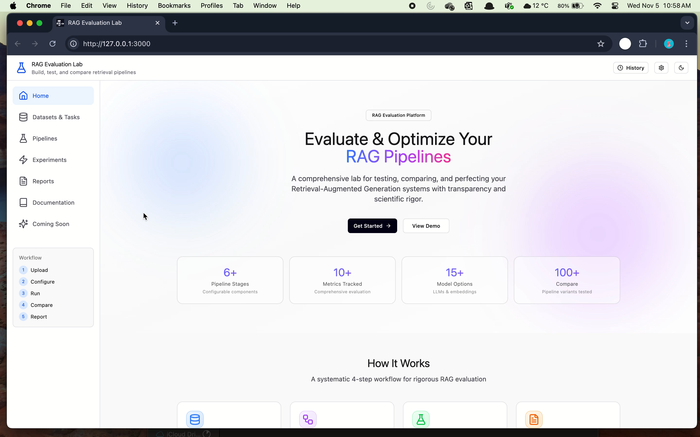

<div align="center">

#  RAG Evaluation Lab

**A comprehensive platform for building, testing, and evaluating Retrieval-Augmented Generation pipelines**

[](https://www.typescriptlang.org/)
[](https://reactjs.org/)
[](https://nodejs.org/)
[](https://expressjs.com/)
[](https://github.com/farhan1301/RAG-Evaluation-Lab/actions/workflows/ci.yml)

[Features](#-features) • [Tech Stack](#️-tech-stack) • [Quick Start](#-quick-start) • [API Reference](#-api-reference) • [Documentation](#-documentation)

</div>

---

## 📖 Overview

RAG Evaluation Lab is an end-to-end workspace for building, running, and evaluating retrieval-augmented generation (RAG) pipelines. The platform provides a modern, intuitive interface for managing datasets, configuring multi-stage pipelines, running experiments, and analyzing results with comprehensive metrics.

### Architecture

- **Frontend**: Vite + React application with Tailwind CSS for orchestrating datasets, pipelines, experiments, and reporting
- **Backend**: TypeScript Express service handling OpenAI, Qdrant, and LlamaParse integrations

---

## 🛠️ Tech Stack

### Frontend
- **Framework**: React 18 with TypeScript
- **Build Tool**: Vite
- **Styling**: Tailwind CSS
- **UI Components**: Radix UI primitives
- **State Management**: React Context API

### Backend
- **Runtime**: Node.js 18+
- **Framework**: Express.js
- **Language**: TypeScript
- **Key Integrations**:
  - OpenAI API (embeddings & chat)
  - Qdrant (vector database)
  - LlamaParse (document parsing)

---

## 🎥 Demo

Click the image below to watch a demonstration of the platform:

[](https://drive.google.com/file/d/1N9gWsj2-VUxENEvvmErER1WbRtXOn-Ph/view?usp=sharing)


---

## ✨ Features

### 🎯 Core Capabilities

- **Guided Workflow**: Interactive landing page that explains the RAG evaluation process with direct navigation to datasets and experiments
- **Dataset Management**:
  - Drag-and-drop file uploads with real-time status tracking
  - Curated sample datasets for quick starts
  - CSV import with flexible header alias support
- **Multi-Pipeline Configuration**:
  - Configure complete RAG pipelines with granular control over each stage
  - Parsing, chunking, embeddings, retrieval, reranking, LLM, and judge configurations
  - Baseline selection and pipeline duplication for easy experimentation
- **Intelligent Experiment Runner**:
  - Auto-parsing of documents on-demand
  - Real-time progress logging
  - Comprehensive metrics: latency, token usage, and cost tracking
  - Automatic persistence of experiment runs
- **Advanced Reporting**:
  - Pipeline comparison with metric deltas
  - Automated recommendations for optimal configurations
  - Export capabilities (Markdown and PDF)
- **Document Processing**: LlamaParse-powered ingestion for consistent parsing with extensibility for additional techniques

### 🚀 Coming Soon

View our roadmap for upcoming features including additional model support, advanced reranking, dark mode, and enhanced metrics.

---

## 📁 Repository Structure

```
RAG Evaluation Lab/
├── frontend/              # Vite + React UI application
│   ├── src/
│   │   ├── components/   # Feature pages (Datasets, Pipelines, Experiments, Reports, etc.)
│   │   ├── state/        # React context providers for global state
│   │   └── lib/          # Utilities (chunking, CSV parsing, API client)
│   └── package.json
├── backend/              # TypeScript Express API server
│   ├── src/
│   │   ├── lib/         # Client libraries (OpenAI, Qdrant, LlamaParse)
│   │   └── routes/      # API endpoints (chunks, search, answer, judge, parse)
│   ├── scripts/         # Verification and setup utilities
│   └── sample-data/     # Sample assets for testing
├── favicon/             # Application icons
├── .env.example         # Environment variable template
└── .env.local          # Local overrides (gitignored)
```

---

## 📋 Prerequisites

Before getting started, ensure you have the following:

| Requirement | Version | Notes |
|------------|---------|-------|
| Node.js | 18+ | JavaScript runtime |
| npm | 9+ | Package manager |
| Qdrant | Latest | Vector database (cloud or local) |
| OpenAI API Key | - | For embeddings and chat completions |
| LlamaParse API Key | - | Document parsing service |

---

## 🚀 Quick Start

### 1. Clone and Install

```bash
# Clone the repository
git clone <repository-url>
cd "RAG Evaluation Lab"

# Copy environment template
cp .env.example .env.local
```

Edit `.env.local` with your API keys and configuration:

```bash
# Required environment variables
OPENAI_API_KEY=your_openai_api_key
QDRANT_URL=your_qdrant_url
LLAMA_CLOUD_API_KEY=your_llamaparse_api_key
VITE_BACKEND_URL=http://localhost:7070
```

### 2. Install Dependencies

```bash
# Install frontend dependencies
cd frontend
npm install

# Install backend dependencies
cd ../backend
npm install
```

> **Security Note:** Never commit API keys to version control. Keep all secrets in `.env.local` (gitignored) or use a secure secret management system.

### 3. Run the Application

**Terminal 1 - Start Backend:**
```bash
cd backend
npm run dev
# Server starts at http://localhost:7070
```

**Terminal 2 - Start Frontend:**
```bash
cd frontend
npm run dev
# Application opens at http://localhost:5173
```

> **Tip:** Use `npm run dev:watch` in the backend for auto-restart on file changes during development.

---

## ⚙️ Configuration

### Environment Variables

Both frontend and backend read environment variables from the repository root via `dotenv`. The `.env.local` file overrides `.env` for local development.

#### Required Variables

| Variable | Description |
|----------|-------------|
| `OPENAI_API_KEY` | OpenAI API key for embeddings and chat completions |
| `QDRANT_URL` | Qdrant cluster URL (cloud or local instance) |
| `LLAMA_CLOUD_API_KEY` or `LLAMA_PARSE_API_KEY` | LlamaParse API key for document parsing |
| `VITE_BACKEND_URL` | Backend API URL for frontend requests |

#### Optional Variables

See `.env.example` for the complete list of optional configuration variables including model selection, collection names, CORS settings, and logging options.

---

## 🔌 API Reference

The backend provides the following REST endpoints:

| Endpoint | Method | Description |
|----------|--------|-------------|
| `/health` | GET | Health check and readiness probe |
| `/api/chunks` | POST | Upsert document chunks with embeddings to Qdrant |
| `/api/search` | POST | Perform vector search against Qdrant collections |
| `/api/answer` | POST | Retrieve context and synthesize answers via LLM |
| `/api/judge` | POST | Evaluate answer quality using LLM-as-judge |
| `/api/parse` | POST | Parse documents via LlamaParse |

### Metrics and Evaluation

The platform calculates comprehensive metrics from actual LLM evaluations:
- Pass rate and quality scores
- Context precision and groundedness
- Latency (p50, p95, p99)
- Token usage and cost per query

All metrics are derived from real model calls rather than heuristics, ensuring production-ready quality signals.

---

## 🏗️ Production Deployment

### Build for Production

```bash
# Build frontend (outputs to frontend/build)
cd frontend
npm run build

# Build backend (outputs to backend/dist)
cd ../backend
npm run build
npm start
```

### Deployment Recommendations

- **Frontend**: Deploy the `frontend/build` directory to a static hosting service (Vercel, Netlify) or CDN
- **Backend**: Run the Node service behind an API gateway or load balancer with proper HTTPS/TLS
- **Security**: Configure authentication, rate limiting, and request quotas before public deployment

### NPM Scripts (Root Directory)

Convenient scripts for running commands from the repository root:

```bash
npm run dev              # Start frontend dev server
npm run dev:frontend     # Start frontend dev server (explicit)
npm run dev:backend      # Start backend dev server
npm run build            # Build frontend
npm run build:backend    # Build backend
```

---

## 🧪 Testing and Verification

### API Smoke Tests

Verify your API credentials and infrastructure without running the full UI:

```bash
cd backend

# Test individual endpoints
npx ts-node --swc ./scripts/verify-chunks.ts   # Test chunk upsert
npx ts-node --swc ./scripts/verify-search.ts   # Test vector search
npx ts-node --swc ./scripts/verify-answer.ts   # Test answer generation
npx ts-node --swc ./scripts/verify-judge.ts    # Test evaluation
npx ts-node --swc ./scripts/verify-parse.ts    # Test document parsing
```

### Qdrant Setup

Initialize Qdrant with the required payload index:

```bash
cd backend
npx ts-node --swc ./scripts/setup-qdrant-index.ts
```

This creates the `pipelineId` payload index needed for pipeline-aware vector operations.

---

## 📚 Documentation

### Implementation Overview

This section provides detailed information about the architecture, components, and implementation details of the RAG Evaluation Lab.

### Backend (`/backend`)

#### Goals
- Provide a TypeScript + Express façade that keeps OpenAI, Qdrant, and LlamaParse credentials out of the browser.
- Offer a complete RAG evaluation pipeline: ingest documents, embed chunks, retrieve context, draft answers, judge responses, and expose per-pipeline analytics.
- Centralize configuration, logging, and CORS controls so the frontend and backend share a consistent runtime story, plus scripts that sanity-check each API surface.

#### Key Components
| Location | Description |
| --- | --- |
| `package.json`, `tsconfig.json` | Node/TypeScript scaffolding (ES modules, `tsx` dev runner, `tsc` build output). |
| `src/lib/config.ts` | Loads env vars (merging `.env` + `.env.local`) and maps vector dimensions to per-size Qdrant collections (`QDRANT_COLLECTION_1536`, `QDRANT_COLLECTION_3072`). |
| `src/lib/logger.ts` | Structured logging to both console and `logs/app.log`, with opt-in console suppression for verbose LlamaParse noise. |
| `src/lib/openaiClient.ts` | Embedding + chat helpers that surface latency, token usage, GPT‑5 model quirks, and response-format support. |
| `src/lib/qdrantClient.ts` | Pipeline-aware collection manager (sanitizes names, ensures payload indexes, retries deletes, and filters searches per `pipelineId`). |
| `src/lib/llamaParseClient.ts` | Robust LlamaParse integration: resilient uploads, exponential backoff polling, payload normalization (markdown/text), and page-count extraction. |
| `src/routes/embeddings.ts` | `POST /api/chunks` – embeds chunk payloads, optionally resets collections, wipes prior pipeline vectors, and returns vector dimension metadata. |
| `src/routes/search.ts` | `POST /api/search` – embeds a query, searches the pipeline-specific collection, and exposes the resolved collection + vector size. |
| `src/routes/answer.ts` | `POST /api/answer` – runs retrieval, composes a grounded answer prompt, returns matches/usage/latency, and mirrors the resolved collection metadata. |
| `src/routes/judge.ts` | `POST /api/judge` – coaxes structured JSON verdicts, aggregates pass rate + average scores, and keeps raw per-task rationales. |
| `src/routes/parse.ts` | `POST /api/parse` – forwards files to LlamaParse with detailed logging, returns normalized text + job IDs, and surfaces configuration gaps with `503`s. |
| `src/index.ts` | Loads environment layers, configures strict CORS allowlists, applies JSON size limits, and mounts every route plus `/health`. |
| `scripts/*.ts` | CLI utilities for bootstrapping Qdrant payload indexes and verifying each API surface end-to-end (chunks, search, answer, judge, parse). |

#### Runtime Expectations
- Required env vars: `OPENAI_API_KEY`, `QDRANT_URL`, and either `LLAMA_CLOUD_API_KEY` or `LLAMA_PARSE_API_KEY` if parsing should be enabled.
- Optional overrides: `OPENAI_EMBED_MODEL`, `OPENAI_CHAT_MODEL`, `QDRANT_API_KEY`, `QDRANT_COLLECTION`, `QDRANT_COLLECTION_1536`, `QDRANT_COLLECTION_3072`, `LLAMA_CLOUD_BASE_URL`, `PORT`, `CORS_ORIGINS`, and the log toggles `LLAMA_PARSE_CONSOLE_LOGS` / `PARSE_ROUTE_CONSOLE_LOGS`.
- Env layering: `.env` is loaded first, then `.env.local` (when present) can override per-developer secrets. `.env.example` documents every key.
- CORS: `CORS_ORIGINS` accepts a comma-delimited allow list. The server blocks unknown origins unless `*` is present.
- JSON payload limit: 16 MB, covering large document uploads while preventing accidental OOMs.
- Start locally via `npm install && npm run dev` (hot reload with `tsx`). Production build uses `npm run build && npm start`.

#### Notable Behaviors
- Pipeline-aware Qdrant usage keeps embeddings partitioned per experiment configuration while automatically provisioning/cleaning collections and payload indexes.
- All external calls (OpenAI, Qdrant, LlamaParse) bubble errors with descriptive messages, helping the frontend display actionable feedback.
- LlamaParse integration includes retry/backoff for uploads/downloads and normalizes heterogeneous payload formats into a consistent `{ text, pageCount }` shape.
- Judge responses request JSON-formatted output, coerce scores into the 0–1 range, and aggregate latency/tokens for downstream cost analysis.
- `backend/scripts/*` give a quick way to validate credentials and infrastructure without running the full UI.

### Frontend (`/frontend`)

#### Goals
- Provide a multi-step workspace (with a polished landing page) for dataset ingestion, pipeline configuration, experiment execution, and results analysis.
- Persist experiment state within React context so datasets, pipelines, and results stay synchronized across pages.
- Surface richer guidance via in-app documentation, experiment history, roadmap previews, and settings scaffolding.

#### Key Modules & Screens
| Location | Highlights |
| --- | --- |
| `src/App.tsx` | Entry shell with sidebar navigation, workflow helper, quick access to History/Reports, and route scaffolding. |
| `src/state/dataset.tsx` | Context for uploaded documents and evaluation tasks, including sample dataset seeding and CSV import updates. |
| `src/state/pipelines.tsx` | Manages pipeline definitions, baseline selection, duplication, timestamp tracking, and strategy defaults. |
| `src/state/experimentResults.tsx` | Tracks experiment stage, status log, chunk previews, per-task results, judge details, and latest `ExperimentRun`. |
| `src/lib/chunking.ts` | Chunking strategies (recursive/semantic/layout/table), sentence-aware splitting, and chunk statistics helpers. |
| `src/lib/taskCsv.ts` | CSV parser that accepts header aliases, surfaces warnings, and hydrates task lists. |
| `src/lib/backend.ts` | Strongly-typed fetch utilities for `/api/parse`, `/api/chunks`, `/api/search`, `/api/answer`, and `/api/judge`, including error parsing. |
| `src/components/DatasetsPage.tsx` | File ingestion with progress UI, removal, sample dataset loader, and CSV task import feedback. |
| `src/components/PipelinesPage.tsx` | Configure parsing, chunking, embedding, retrieval, reranker (placeholder), LLM, and judge stages per pipeline with expand/collapse controls. |
| `src/components/ExperimentsPage.tsx` | Orchestrates runs across multiple pipelines, auto-parses documents when needed, tracks status logs/progress, and rolls up cost + latency estimates. |
| `src/components/ReportsPage.tsx` | Compares pipelines, recommends top configs, highlights metric deltas, and exports Markdown/PDF summaries. |
| `src/components/HistoryPage.tsx` | Presentational scaffolding for browsing previous experiments (seeded data + management affordances). |
| `src/components/DocumentationPage.tsx` | Rich in-app documentation with copy-to-clipboard snippets, tabbed guides, and workflow walkthroughs. |
| `src/components/ComingSoonPage.tsx` | Product roadmap showcasing planned features (re-ranking, model support, dark mode, metrics). |
| `src/components/SettingsPage.tsx` | UX shell for future account/API key management (forms and toggles are presently static). |
| `src/main.tsx` | Binds the dataset, pipeline, and experiment providers so every screen shares the same shared state. |

#### Experiment Pipeline Logic
1. **Prerequisites:** The UI blocks experiment runs until at least one uploaded document (raw content or ready-to-parse file) and one task exist.
2. **Parsing on Demand:** When a pipeline runs, any uploaded-but-unparsed documents are sent to `/api/parse` using the baseline pipeline’s parsing strategy, with status updates fed back into the dataset context.
3. **Chunking:** `chunkDocumentsWithConfig` slices content according to the active pipeline strategy; `summarizeChunkGroups` produces quick stats for the report.
4. **Upsert:** `/api/chunks` embeds every chunk and writes them to the pipeline’s target Qdrant collection. Existing vectors for that pipeline are cleared, and collection metadata (dimension, source collection) is tracked.
5. **Answering:** For each task + pipeline, `/api/answer` performs retrieval, captures cited chunks, latency, and token usage, and normalizes snippets for downstream rendering.
6. **Judging:** Answers feed `/api/judge`, which yields per-task verdicts (pass/review), dimension-specific scores, rationales, latency, and token counts.
7. **Metrics & Costing:** The experiment store computes aggregate metrics (pass rate, context precision, groundedness, latency p95, cost/query, tokens used) and derives “best pipeline” recommendations.
8. **Reporting & Export:** The Reports page compares pipelines, highlights metric deltas against baseline, and offers Markdown/PDF exports summarizing findings and recommended next steps.
9. **Persistence:** The latest `ExperimentRun` snapshot (including configuration copies) is stored in context for Reports, History, and Documentation pages.

### Remaining / Optional Work
- **Authentication & Authorization (critical):** No auth guard or rate limiting exists today; add API keys/session middleware before exposing beyond localhost.
- **Persistent Storage (critical):** Experiment history and settings screens remain static—replace with real storage (backend API, database, or export/import utilities).
- **Parsing Flexibility (critical):** `/api/parse` returns `503` without `LLAMA_CLOUD_API_KEY`; introduce alternative connectors so LlamaParse is optional.
- **Provider Coverage (critical):** Backend only supports OpenAI even though the UI advertises other providers; wire up reranker + additional integrations (Anthropic/Cohere).
- **Roadmap Delivery (critical):** Items showcased on the Coming Soon page (reranking, metrics, dark mode) are not implemented yet.
- **Real-time Feedback:** Consider SSE/websocket progress updates instead of polling to show real-time pipeline stages.
- **Testing & Observability:** Add unit/integration coverage for backend clients/routes, plus telemetry dashboards for token/cost monitoring.
- **Deployment Tooling:** Docker images, CI workflows, and environment templates for staging/production readiness.
- **Access Controls:** Gate admin settings (API keys, roadmap edits) and provide workspace-level isolation when multi-user support arrives.

---

## 🔧 Troubleshooting

### Common Issues

| Issue | Solution |
|-------|----------|
| `ERR_UNKNOWN_FILE_EXTENSION ".ts"` | Use provided `npm run dev` scripts to apply proper TypeScript transpilation |
| `fs.Stats constructor is deprecated` | Reinstall backend dependencies to ensure `tsx` is used instead of `ts-node` |
| `Missing required environment variable` | Verify all required environment variables are set in `.env.local` |
| Express fails to bind to port 7070 | Check if port is in use or override with `PORT` environment variable |
| Backend route errors | Check `backend/logs/app.log` for detailed error messages |
| 503 error on `/api/parse` | Ensure `LLAMA_CLOUD_API_KEY` or `LLAMA_PARSE_API_KEY` is configured |

### Getting Help

- Review the in-app documentation for detailed workflows
- Check the `backend/logs/app.log` file for structured error logs
- Verify all API keys and credentials are valid and have appropriate permissions

---

## 🛣️ Roadmap

### Planned Features

- **Enhanced Model Support**: Integration with additional LLM providers (Anthropic, Cohere)
- **Advanced Reranking**: Implement reranker functionality for improved retrieval accuracy
- **Persistent Storage**: Database integration for experiment history and user settings
- **Authentication & Authorization**: User management and API access controls
- **Additional Parsing Methods**: Local parsers and OCR capabilities
- **Dark Mode**: UI theme customization
- **Enhanced Metrics**: Additional evaluation dimensions and custom metrics
- **CI/CD Pipeline**: Automated testing and deployment workflows

### Before Production

- [ ] Configure HTTPS/TLS for secure communication
- [ ] Implement authentication and rate limiting
- [ ] Add persistent storage for history and settings
- [ ] Set up monitoring and observability
- [ ] Configure proper CORS and security headers

---

## 🤝 Contributing

Contributions are welcome! Please feel free to submit issues, feature requests, or pull requests.

---

## 📄 License

This project is provided as-is for evaluation and development purposes.

---

## 👥 Team

Built by the RAG Evaluation Lab Team

---

<div align="center">

**Happy Experimenting!**

For questions or feedback, please open an issue on the repository.

</div>
